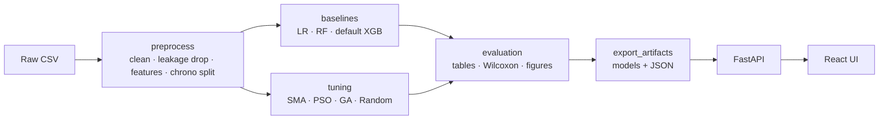
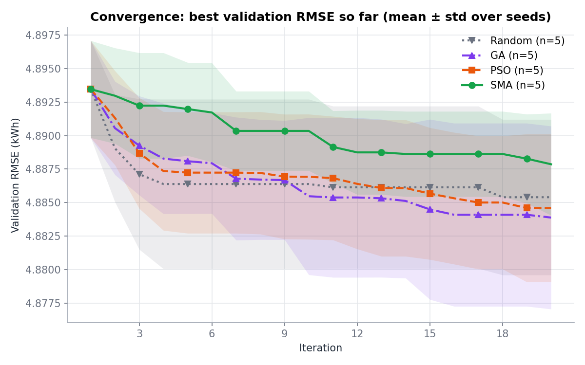
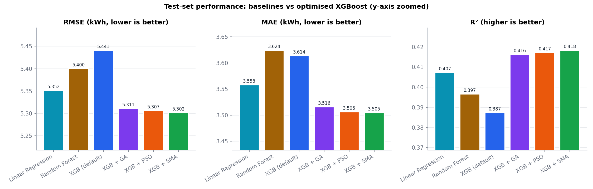
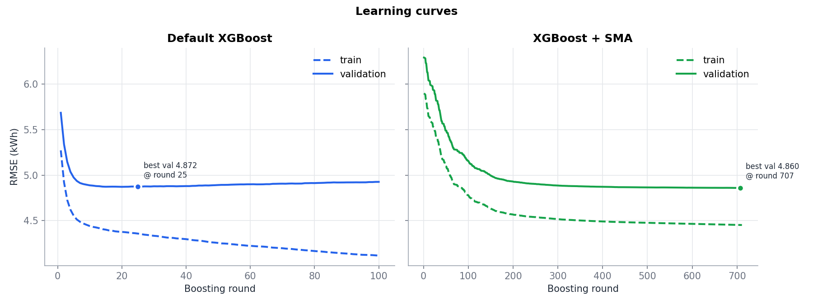
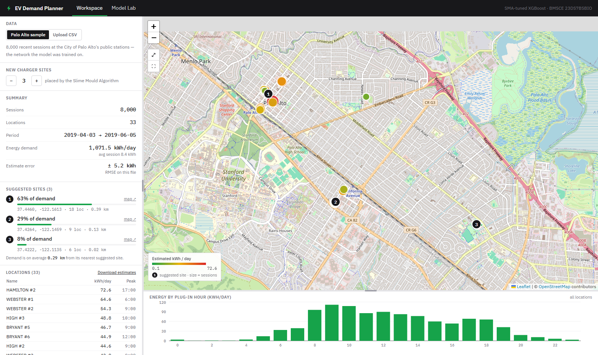
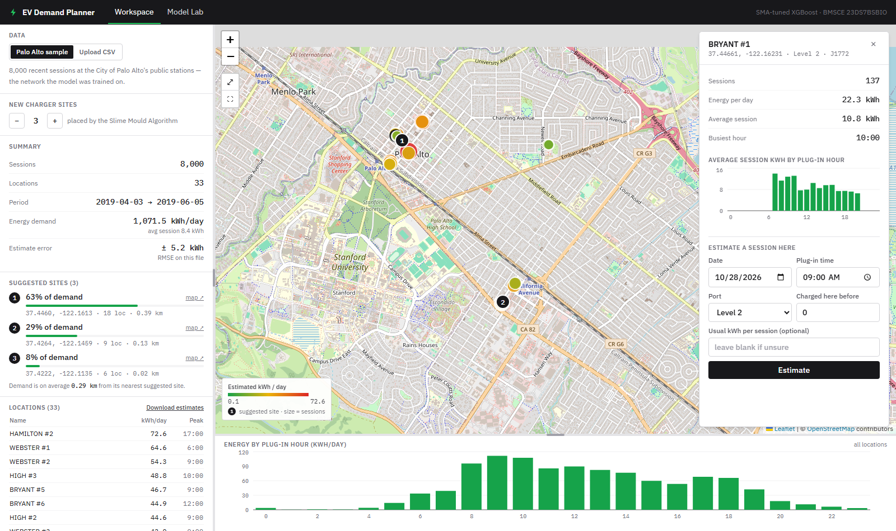
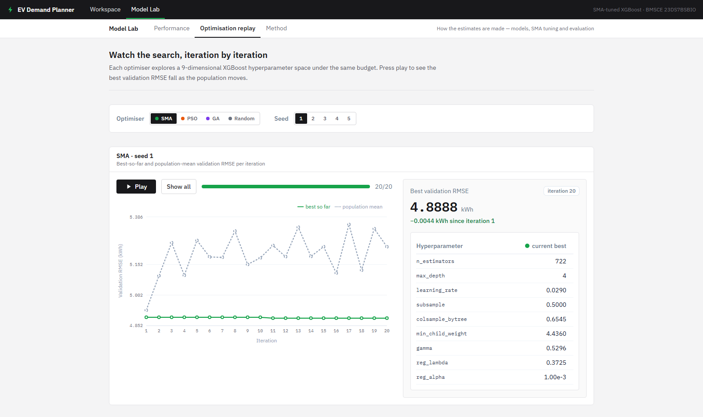

# Slime Mould Algorithm–Optimised XGBoost for EV Charging Energy Demand Prediction
### A comparative study with PSO and GA

Bio-Inspired Algorithms (23DS7BSBIO) AAT · B.E. CSE (Data Science), BMSCE Bengaluru

## Abstract
We predict the energy (kWh) an electric vehicle will draw in a charging session using only information
available when the car plugs in, on 236,852 sessions from the City of Palo Alto's public charging network
(2012–2019). XGBoost is the predictive model. Its nine hyperparameters are tuned by the **Slime Mould
Algorithm (SMA)**, implemented from scratch in NumPy, and compared with Particle Swarm Optimisation,
a real-coded Genetic Algorithm and Random Search under an identical evaluation budget, over 5 seeds each.
All tuned models are evaluated once on a chronologically held-out test set and compared with untuned
XGBoost, Linear Regression and Random Forest. A FastAPI + React web app serves the trained models and
results for a live demo.

## Biological inspiration
*Physarum polycephalum* is a single-celled slime mould that forages by spreading a network of protoplasmic
tubes. Cytoplasm oscillates through the network, and tubes that lead to rich food carry more flow and
**thicken** (positive feedback), while tubes to poor food thin out and disappear. In a well-known experiment,
Tero et al. (*Science*, 2010) placed oat flakes in the positions of the cities around Tokyo, and the slime
mould grew a network strikingly similar to the **Tokyo rail system**.

SMA (Li et al., 2020) turns this into an optimiser:

| Behaviour | Equation | Role |
|---|---|---|
| Vein thickness (weights) | `W = 1 ± r·log10((bF − S)/(bF − wF) + 1)` (+ for the better half) | good cells pull harder |
| Approach food | `X = Xb + vb·(W·X_A − X_B)`, probability `p = tanh\|S − DF\|`, `vb ~ U(−a, a)`, `a = arctanh(1 − t/T)` | exploit around the best food |
| Wrap / contract | `X = vc·X`, `vc ~ U(−b, b)`, `b = 1 − t/T` | oscillating contraction |
| Relocation | random position with probability `z = 0.03` | exploration |

## Problem statement
> Given information available at the moment an electric vehicle plugs in — which station and port, the plug
> type, the time and day, and the driver's past charging behaviour — predict how much energy (kWh) the
> session will consume. Accurate per-session predictions help operators forecast grid load, schedule
> capacity and set prices. We use XGBoost as the predictive model and the bio-inspired Slime Mould Algorithm
> to tune its hyperparameters, and compare it with PSO, GA and the untuned model.

## Dataset
**City of Palo Alto, *Electric Vehicle Charging Station Usage (July 2011 – Dec 2020)*** — one row per charging
session (259,415 rows). The file is downloaded manually and is never fetched by the code:

1. Download it from the City's open data portal:
   <https://data.paloalto.gov/datasets/194693/electric-vehicle-charging-station-usage-july-2011-dec-2020/>
   (the file is called `ChargePoint Data CY20Q4.csv`).
2. Save it as `data/raw/EVChargingStationUsage.csv`.

Column names are mapped in one place, `config.yaml → columns`.

**Sample data from other cities** (`data/sample/`): real session data from **Boulder (USA), Cary (USA) and
Leeds (UK)**, plus measured monthly EV-charging demand for **109 localities in Hyderabad (India)**, all
prepared with `python scripts/fetch_city_samples.py`, ready to upload in the Workspace (*My data*). Each folder has
a `SOURCE.md` with the publisher, licence and processing notes. These files are never used for training; they
show how the Palo Alto model transfers to other cities (see `data/sample/README.md`).

**Preprocessing:** keep 2012-01-01 … 2019-12-31 (2011 has very few sessions; 2020 is distorted by COVID-19);
drop missing / non-positive energy and the top 0.5 % (> 45.97 kWh); engineer plug-in-time features
(cyclical hour/month, weekday, year, station, port/plug type, location, and the user's and station's
history); rare categories (< 50 sessions) become `other`; split **chronologically** 70 / 15 / 15.

### Leakage rule
The target is `Energy (kWh)`. `End Date, End Time Zone, Total Duration, Charging Time, GHG Savings,
Gasoline Savings, Fee, Ended By, Transaction Date` are known only **after** the session ends, or are computed
from energy, so they are dropped. Using them would give an unrealistically high R² and make tuning pointless.
The history features (`user_prev_*`, `station_prev_mean_kwh`) are computed on time-sorted rows from
**strictly earlier** sessions only. Both rules are asserted in code and covered by tests.

## Why XGBoost
* The data is tabular with mixed categorical and numeric features, where gradient-boosted trees are the
  strongest standard choice.
* XGBoost captures non-linear interactions (station × hour × user history) and handles missing values natively.
* Its many interacting continuous and integer hyperparameters (search space below) make it an ideal target
  for a continuous metaheuristic.

| # | Hyperparameter | Range | Decoding |
|---|---|---|---|
| 1 | n_estimators | 100 – 1000 | linear, int |
| 2 | max_depth | 3 – 12 | linear, int |
| 3 | learning_rate | 0.01 – 0.3 | log-uniform |
| 4 | subsample | 0.5 – 1.0 | linear |
| 5 | colsample_bytree | 0.5 – 1.0 | linear |
| 6 | min_child_weight | 1 – 10 | linear |
| 7 | gamma | 0 – 5 | linear |
| 8 | reg_lambda | 1e-3 – 10 | log-uniform |
| 9 | reg_alpha | 1e-3 – 10 | log-uniform |

**Fitness** is validation RMSE of XGBoost trained on a fixed 40,000-row training subsample, with early
stopping, and cached by the rounded hyperparameters. The budget is the same for every optimiser:
population 15 × 20 iterations (≤ 300 evaluations), seeds 1–5. The best configuration is re-fitted on the
full training set and evaluated **once** on the test set. The best seed per optimiser is chosen on
validation RMSE, never on test.

## Pipeline


## How to run
### ML pipeline (Python 3.11)
```bash
py -3.11 -m venv .venv            # Windows (Linux/macOS: python3.11 -m venv .venv)
.venv\Scripts\activate            # Linux/macOS: source .venv/bin/activate
pip install -r requirements.txt

python -m src.data.preprocess          # → data/processed + results/eda
python -m src.experiments.run_benchmarks
python -m src.experiments.run_baselines
python -m src.experiments.run_tuning   # longest step (~4–5 h on a laptop); resumable
python -m src.experiments.summarize    # → tables + all figures + results/summary.md
python -m src.experiments.export_artifacts   # → results/models + results/api (for the web app)
pytest -q
```
* `run_tuning --quick` is a smoke test that runs the whole pipeline in a few minutes
  (pop 6, 5 iterations, 1 seed, 10k-row sample).
* `run_tuning --optimizers sma pso --seeds 1 2` runs a subset. A run whose JSON already exists is skipped,
  so you can stop and restart the tuning safely.
* `.\scripts\run_all.ps1` (Windows) or `scripts/run_all.sh` runs every step, and `-Quick` / `--quick` uses quick mode.
* The notebook `notebooks/SMA_XGBoost_EV_Demand.ipynb` walks through the pipeline for the demo.

### Web app (two terminals)
```bash
uvicorn backend.main:app --reload --port 8000          # API → http://localhost:8000/docs
cd frontend && npm install && npm run dev              # UI  → http://localhost:5173
```
Copy `frontend/.env.example` to `frontend/.env` to change the API URL. The backend reads `results/`, which
you can override with `RESULTS_DIR`. If the artifacts are missing, it still starts and every endpoint returns
HTTP 503 with instructions.

## Results
<!-- RESULTS:START -->
*The full tuning run is in progress; this section is filled in from `results/summary.md` when it completes.*
<!-- RESULTS:END -->

Key figures:

| Convergence | Baseline vs optimised | Learning curves |
|---|---|---|
|  |  |  |

All tables (dataset, baselines, final comparison, tuning summary, best hyperparameters, Wilcoxon,
benchmarks) and the full figure list are in [`results/summary.md`](results/summary.md).

## Web app
| Workspace | Location details | Model Lab |
|---|---|---|
|  |  |  |

The app is one unified platform with two parts. The user-facing pages show no model internals; everything
technical lives in a separate **Model Lab**.

**Workspace** (`/`) — a map-first planning tool, for the built-in Palo Alto sample *or* an uploaded CSV
from any city:
* **Side panel:** data source (Palo Alto sample / upload), number of new charger sites, a summary (sessions,
  locations, period, energy demand, estimate error), the **SMA-suggested charger sites**, a ranked location list
  (with a CSV download of per-session estimates) and how the sites were chosen.
* **Map:** every location, sized by activity and coloured by kWh per day, plus numbered suggested sites. The same
  from-scratch Slime Mould Algorithm solves a weighted p-median problem (`src/placement/charger_sites.py`).
* **Location details** (click a circle or a list row): sessions, energy per day, average session, busiest hour,
  hourly profile, and **"Estimate a session here"** (date, time, port, optional driver history) giving the
  estimate, a likely range, the charging time and a comparison with the location's average.
* **Chart strip:** energy by plug-in hour (session files) or by month (demand files).
* Session files need a start time, latitude and longitude (station, port/plug, driver ID and kWh optional).
  **Demand files** (location + measured kWh, optionally per month, e.g. Hyderabad) are detected automatically.
  The ML model is never retrained; areas far from Palo Alto get a warning that absolute kWh may not transfer.

**Model Lab** (`/lab`)
* **Performance** (`/lab`) — headline metrics, model leaderboard, baseline-vs-optimised bars, mean
  convergence, predicted-vs-actual scatter, feature importances.
* **Optimisation replay** (`/lab/optimization`) — iteration-by-iteration replay of any optimiser and seed,
  plus the best hyperparameters found by each optimiser.
* **Method** (`/lab/method`) — SMA biology, the four operators and the loop diagram; the dataset and the
  leakage rule.

## Project structure
The project is three programs (the ML pipeline, the API and the website) plus folders they fill in.

```
EV Charging Station Placement/
├── src/                      1 · ML pipeline (the marked part)
│   ├── data/                 load.py · preprocess.py (cleaning, leakage rule, features, split) · eda.py
│   ├── models/               baselines.py (LR, RF, XGBoost) · xgb_space.py (9-D search space, fitness, cache)
│   ├── optimizers/           sma.py · pso.py · ga.py · random_search.py (from scratch) · base.py · benchmarks.py
│   ├── placement/            charger_sites.py — SMA chooses new charger sites (weighted p-median)
│   ├── evaluation/           metrics.py (RMSE, MAE, R², sMAPE) · stats.py (Wilcoxon)
│   ├── experiments/          the pipeline steps: run_benchmarks → run_baselines → run_tuning → summarize → export_artifacts
│   ├── viz/plots.py          every result figure
│   └── config.py             loads config.yaml, seeding
├── backend/                  2 · FastAPI server — reads results/, never trains
│   ├── routers/              HTTP endpoints (predict, stations, results, optimization, area)
│   ├── services/             model/results loading, feature building, area analysis
│   ├── schemas.py            request/response models
│   └── main.py               app entry point
├── frontend/                 3 · React website (only src/ is project code; the rest is tool config)
│   └── src/
│       ├── pages/            Workspace.tsx (map-first tool) · lab/ (Performance, Optimization, Method)
│       ├── components/       ui/ (cards, icons, navbar) · charts/ · workspace/ (map, location panel)
│       └── api/ · types/ · hooks/ · theme.ts
├── tests/                    pytest: ml/ (metrics, optimisers, search space, preprocessing, placement)
│                             api/ (every endpoint) · fixtures/ (synthetic test data)
├── notebooks/                SMA_XGBoost_EV_Demand.ipynb — demo walkthrough
├── scripts/                  run_all.ps1 · run_all.sh (whole pipeline) · build_notebook.py · fetch_city_samples.py
├── docs/                     screenshots/ for the README and report
├── data/                     raw/ (training CSV) · processed/ (generated) · sample/ (other cities)
├── results/                  tables, figures, models, API files (all generated)
├── config.yaml               every tunable value
├── requirements.txt          pinned Python packages
└── pyproject.toml            project metadata + pytest settings
```

`data/processed/` and everything in `results/` can be deleted and recreated by re-running the pipeline.

## Reproducibility and tests
* Every optimiser owns a `np.random.default_rng(seed)` and never uses the global RNG. Same config → same
  numbers.
* `pytest -q` runs the unit tests (metrics, optimisers on Sphere, search-space decoding, leakage and the
  chronological split) and API tests. The API tests build real artifacts by running the whole pipeline on a
  small synthetic dataset.

## Known limitations
* The data is from Palo Alto, USA, and usage patterns may differ from Indian cities. The method transfers;
  the numbers may not.
* Per-session energy has high natural variance (driver behaviour), so R² is moderate. The goal is the
  improvement from tuning, not a perfect predictor.
* Tuning uses a training subsample for speed; the tuned hyperparameters are re-fitted on the full data.
* There are only 5 seeds per optimiser, so the Wilcoxon tests have limited power (with 5 pairs the smallest
  possible two-sided p-value is 0.0625).
* In the normalised [0, 1] space, SMA's wrap move `X = vc·X` contracts toward 0, i.e. toward the lower
  bound of every hyperparameter. This is a property of the original algorithm, whose benchmark optima lie
  at 0. It is kept for faithfulness, and it explains SMA's weaker benchmark scores relative to PSO and GA.

## Team
* Team member 1 — USN
* Team member 2 — USN
* Team member 3 — USN

## References
1. S. Li, H. Chen, M. Wang, A. A. Heidari, S. Mirjalili, "Slime mould algorithm: A new method for stochastic optimization," *Future Generation Computer Systems*, 111, 300–323, 2020.
2. A. Tero et al., "Rules for biologically inspired adaptive network design," *Science*, 327(5964), 439–442, 2010.
3. T. Chen, C. Guestrin, "XGBoost: A scalable tree boosting system," *Proc. KDD*, 2016.
4. J. Kennedy, R. Eberhart, "Particle swarm optimization," *Proc. IEEE ICNN*, 1995.
5. J. H. Holland, *Adaptation in Natural and Artificial Systems*, University of Michigan Press, 1975.
6. K. Deb, R. B. Agrawal, "Simulated binary crossover for continuous search space," *Complex Systems*, 9, 115–148, 1995.
7. City of Palo Alto, "Electric Vehicle Charging Station Usage (July 2011 – Dec 2020)," open data portal.
8. J. Bergstra, Y. Bengio, "Random search for hyper-parameter optimization," *JMLR*, 13, 281–305, 2012.
